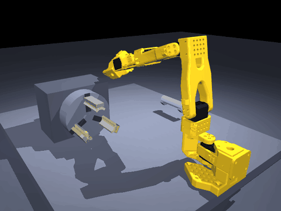

# mujoco-robot-cell

**一个 MuJoCo 机器人工作站，一站一站往上搭。**
*A MuJoCo robot cell, built one station at a time.*

现在跑通的是车床上下料：SO-101 抓起 Φ20 圆柱工件，送进三爪卡盘夹紧。
**搬运段没有用运动学锁**——工件是靠夹爪几何和接触力真被抓住的。

> Station 1 online — lathe tending. A SO-101 picks a Φ20 cylinder and seats it in a
> 3-jaw chuck. The carry segment uses **no kinematic lock**: contacts carry the part.
> All checks below were measured, not assumed.



```
同轴度        0.94 mm      工件轴线 vs 卡盘轴线偏差
轴线倾斜       0.0°        夹紧后姿态（用轴线方向算，不是四元数转角）
接触点           6 个       三爪各 2 点，全部真实接触
重力下沉      0.00 mm      解锁后靠自重不掉
20 N 拉拔     0.92 mm      轴向拉力下的位移
三爪法向力    21.1 N       卡盘实际夹持力
抓取轴向偏     3.1°        夹紧瞬间工件轴 vs 卡盘轴
搬运方式      physics      无运动学锁，全程真实接触
```

`verify_all.py` **8/8 PASS，约 26 秒**，纯 CPU，不需要显卡。

```bash
python src/diag_feed_chuck.py --v-jaw --lift --no-lock    # 只看这一条：全物理送料
```

*Coaxiality 0.94 mm · axis tilt 0.0° · 6 real contacts · 0.00 mm sink · 0.92 mm pull-out
under 20 N · 21.1 N grip force · carry = physics.*

---

## 三行摘要

| | |
|---|---|
| **做到了什么** | 圆柱工件从台面被真实抓住（形封闭 + 摩擦），搬过整个工作区，送进三爪卡盘夹紧，20 N 拉拔不掉。8 项判据全过。 |
| **哪里还有问题** | 画面一顿一顿；机械臂走位一晃一晃；送进卡盘时是**斜着穿模**过去的——卡盘外壳没参与碰撞，真机会撞床身。 |
| **要走到哪** | 一个能逐日迭代的学习大本营：先把仿真里的接触做到可信，再往视觉、遥操作、自训练策略走，最终给出**泛化**上的成果——换位姿也能成，而不只是复现固定路线。 |

---

## 最近在做什么（工程日志，倒序）

> **2026-11-06 · 工件真的被抓住了，搬运段拿掉运动学锁**

以前 7/7 里的搬运段是把工件**钉**在手上的，夹爪其实什么都没夹住。
今天把这件事做实，全物理跑通：

```
同轴 0.94 mm · 轴向偏 0.0° · 三爪接触 6 点
重力下沉 0.00 mm · 20 N 拉拔 0.92 mm · 三爪力 21.1 N
carry = physics（无锁）
```

根因是三个叠在一起的几何错误，**每一个单独看都像"摩擦不够"**：

1. **手指闭合方向斜着搓工件。** `wrist_roll = 1.55` 下活动指行程
   `[16.3, 25.6, 4.5] mm`——一半在顺着工件轴向推。量化后 1.55 有 50%
   行程沿轴，−0.95 只有 12%。改成 −0.95。
2. **两片指垫不在同一轴向位置。** 原装 SO-101 固定指面比活动指面靠后
   **14.8 mm**，各自切 V 槽 → 两个槽口沿轴错开 **15.4 mm**，夹爪是在
   "啃"圆柱不是"托"圆柱。统一到同一轴向工位后错开 1.9 mm，轴线偏离
   20° → 4.3°。
3. **瞄准点随开合漂 21 mm。** 只有一片指在动，两片指垫中点每次开合会滑
   半个行程。手臂瞄着工件，闭合后爪子落在旁边 21 mm。把两个 `grasp_ref`
   都钉在不动的那片指上（TCP 恒定），瞄准误差归零。

> **2026-11-06 · 同时发现三个观感问题（未修，明天做）**

工件确实进去了，但画面不像真机：窗口一顿一顿、手臂一晃一晃、送进卡盘时
斜着**穿模**过去。指标仍 8/8 PASS——说明是"动能过、但不真"。
详见[已知问题](#已知问题暂时只是观感但不修会出事)。

> **2026-11-05 · 从 6/7 修回 7/7**

- 虎钳和浅槽平台从场景里删掉，工件换成纯 Φ20 圆柱
- 定位到**带载稳态下沉**：重复发同一个绝对目标是错的，改积分补偿（残差 24.8 → 1.2 mm）
- 定位到**交接时序**才是真卡点：机器人松手瞬间手臂仍在退让，会把工件一起拖走
- 卡爪 28 → 55 mm；夹紧量扫 4 档，取 `-0.010`
- 3D 窗口改成热重载，改场景不用重启
- 加了常驻窗口 + 后台推帧，跑仿真能实时看到画面
- 仓库重新分层：代码进 `src/`，生成物进 `_build/`，根目录从 70 项降到 13 项

---

## 这只夹爪改了四版

夹爪是整件事里返工最多的部分，四版全留着记录，因为它们正好说明
"一个看着像摩擦的问题，最后是几何问题"。

| 版本 | 做法 | 结果 | 为什么不行 |
|---|---|---|---|
| **v1 平板指垫** | SO-101 原装平指，直接夹 | 闭合就歪 46°，5 N 下拉滑 **467 mm** | 平板夹圆柱只有**线接触**，扛不住倾覆力矩。扫摩擦系数没用——不是光滑的问题 |
| **v2 V 槽（第一版）** | 两片指各切 90° V 槽 | 4 点接触 105 N，下拉只 2.3 mm，但轴线偏 **20°** | 两片指垫轴向本来错开 14.8 mm，两个槽口错开 15.4 mm，等于两个错开的 V 在"啃"圆柱 |
| **v3 圆弧软爪** | 两片开半圆孔，闭合合成 Φ20.6 圆孔整圈"笼"住 | 闭合瞬间工件被弹飞 123°、792 mm | 先撞后夹：孔还没到位就压到工件。这条路没走通，代码留在 `src/arc_jaws.py` 并标注**已废弃** |
| **v4 V 槽（修好后）** | 槽口对齐到同一轴向工位 + 手腕 −0.95 + TCP 钉在固定指 | 同轴 0.94 mm、轴向偏 0.0°、20 N 拉 0.92 mm | 能用了。但见下面限制：靠 μ=0.05 还算得上紧 |

v2 到 v4 之间还试过一条**加长手指 12 mm 让基座躲开工件**——失败，因为"伸出方向"
算错了：用"基座原点 → 两指中点"当方向，实际偏了约 40°，加长等于把槽口斜着推走。

> 结论写在这儿：**v1 的失败是真结论**（平板抓不住圆柱，不受任何 bug 影响）；
> v2 的失败是**测量错误**导致的假结论。分辨这两者花了很长时间。

---

## 大目标：这是学习大本营，不是一次性 demo

这个仓库的第一用途是**记录每天在学什么**，第二用途才是作品。

四层目标，难度差着数量级，**现在只站在第一层**：

| 层 | 内容 | 状态 |
|---|---|---|
| ① 跑通一个任务 | 仿真里把"抓起来 → 送进卡盘"做到接触可信 | ✅ 8/8 |
| ② 别人能一键复现 | clone 下来 30 秒跑出结果，有判据有动图 | ✅ 基本成立 |
| ③ 参数化实验 | 爪型 / 直径 / 摩擦扫一遍，写成能引用的报告 | ○ 下一步 |
| ④ 自训练策略、大模型设计爪型 | 通用性、泛化，实验室前沿 | ○ 远期 |

**为什么顺序不能反**：③ 之前的仿真环境本身还不可信（现在就有穿模），
在这上面训出来的策略学的是"穿模也能过"的物理，数据集整批作废。
所以近期的取舍很明确：**先把仿真的可信度做实，再谈训练**。

发布路线也想清楚了：代码留 GitHub；**权重、数据集、在线 demo 走 Hugging Face**
（它的搜索按 model / dataset 找，没人按代码找）。而发布门槛不是"训练跑通了"，
是**泛化**——换工件初始位姿仍能成功。前两条（速度、一致性）赢了只是复现。

---

## 这个 cell 里有四个工位

仓库不是"一个车床项目"，是一个可以不断加工位的仿真工作站。车床只是第一个做完的：

| 工位 | 状态 | 靠什么 | 目录 |
|---|---|---|---|
| **车床上下料** | ✅ 8/8 通过 | 手写 IK + 位置伺服 + V 槽形封闭 | `src/scene_machining.py` |
| 视觉引导抓取 | ○ 下一步 | 相机标定 + 位姿估计 | 计划 `scenes/vision_pick/` |
| 手势遥操作 | ○ 计划 | 手部关键点 → 末端映射 | 计划 `teleop/` |
| 视频示教 / 模仿学习 | ○ 计划 | BC / ACT 训练 | 计划 `learning/` |

**这四个不是四选一，是一条数据链**：视觉引导先解决"看得见"；手势遥操作解决
"人怎么教"，顺带录下 `(观测, 动作)` 序列；那批序列就是模仿学习的训练集。

---

## 第一个工位解决了一个什么问题

真实车床上下料最难的**不是**抓起来，是**交出去**。

工件从机器人手里转到卡爪手里，中间有一个瞬间谁都不能碰它——机器人还夹着、
卡爪又去夹，两个夹具抢同一根轴，输的那台伺服被拖偏（实测 6.46 mm）；机器人
松手了但手还在原位，卡爪把工件往里推，会推着还张着的指垫后退（实测 12.07 mm）。

答案是：**先把工件钉死在世界坐标 → 手臂退开 55 mm → 三爪再夹紧**。

`lock()` 只固定 `qpos`，不消除接触力。卡爪推工件的力会经指垫传到手臂，手臂一
退让，锚在手臂上的锁就把工件一起搬走。所以必须有一个"谁都不碰它"的瞬间。

这条不在任何教程里，是 3 次失败实测出来的。

> 注：这里说的"钉死"是**交接那一瞬**的辅助手段（`kinematic_lock`），和搬运段
> 现在用的全物理不矛盾——搬运已经不需要它了。

---

## 30 秒跑起来

```bash
git clone https://github.com/penguinkinggod/mujoco-robot-cell.git
cd mujoco-robot-cell

uv venv --python 3.12 .venv
uv pip install --python .venv/Scripts/python.exe -r requirements.txt

python verify_all.py
```

Windows / Linux / macOS 都能跑，**不需要显卡**，MuJoCo 纯 CPU。

实测版本：Python 3.12.15 / mujoco 3.17.0 / numpy 2.5.4 / matplotlib 3.11.2 / imageio 2.38.1。

想直接看画面（两个进程都要起，缺一个窗口就不会动）：

```bash
python src/live_bridge.py view        # 常驻 3D 窗口，负责"画"
python src/live_bridge.py run --loop  # 跑仿真并推帧，负责"演"
```

---

## 8 项指标怎么验的

`verify_all.py` 一次跑完 8 个检查，任何一项不过退出码非 0：

| 检查 | 验什么 | 通过标准 |
|---|---|---|
| 语法检查 | 核心脚本能不能编译 | 全部通过 |
| 车床场景编译 | 场景 XML 能不能编译成模型 | 无报错 |
| 夹具落料 13/13 | 工件在托架/槽上的落位几何 | 13 项全过 |
| 卡盘夹紧 | 三爪夹 Φ20 的实际夹持 | 接触 ≥ 6，不下沉 |
| 卡盘工位体检 | 卡盘 IK 可达性 | 卡盘口残差 ≤ 15 mm |
| 完整序列 3/3 | 三个版本的送料序列 | 3/3 完成（**不查姿态**） |
| 机械臂送料装夹 | 送料全流程（平板爪 + 交接锁） | 同轴 ≤ 2 mm，接触 ≥ 6，20 N 拉拔不位移 |
| **送料·全物理(V槽)** | **V 槽 + 无锁，真实接触承担载荷** | 同上，且 `carry=physics`、`physics_after_clamp=1` |

**这些数字是量出来的，不是设的。** 每个都有对应诊断脚本，可以单独跑、单独改参数。

---

## 底层是可以复用的

换工位时，下面这几层不换：

```
core/（计划）
├─ lock.py        把刚体钉在世界坐标，切断接触力传递
├─ handoff.py     两个执行器交接同一物体时的时序
├─ metrics.py     同轴度 / 接触数 / 拉拔位移 的量测
└─ camera.py      相机标定与图像采集

scene_machining   抓取 → 交接 → 夹紧 → 拉拔测试
scene_assembly    抓取 → 对齐 → 插入 → 紧固测试     （计划）
scene_vision      识别 → 定位 → 抓取 → 验证          （计划）
```

这次车床踩出来的"钉死 → 退开 → 夹紧"，装夹场景一模一样要用。
**场景会换，交接逻辑不换。**

---

## 入门教学线（demo_00–07）

从"仿真器是什么"走到"怎么判断结果对不对"：

| 文件 | 教你什么 | 结果 |
|---|---|---|
| `demo_00_check.py` | `model` + `data` + `mj_step` 三件套 | 打印 `OK` |
| `demo_01_pendulum.py` | PD 为什么有静差，重力前馈补掉 | 误差 0.00° |
| `demo_02_arm.py` | 关节角 ↔ 末端位置，雅可比伪逆 | 末端误差 0.0000 m |
| `demo_03_camera_dataset.py` | 具身智能的数据长什么样 | `(图像, 关节角, 动作, 目标)` |
| `demo_04_panda_grasp.py` | 真机模型抓取：IK + 伺服 + 接触摩擦 | 抬高 0.157 m |
| `demo_05_toolpath.py` | 开环 vs 闭环，误差怎么累积 | 3D 轨迹对比 |
| `demo_06_learn_correction.py` | 机器学习和仿真的关系 | 一次实验说清 |
| `demo_07_turned_parts.py` | 车削件几何与工艺可行性 | 参数扫描 |

全部在 `src/` 下，逐个跑即可：`python src/demo_00_check.py`。生成的图落在 `_build/`，不进版本库。

---

## 踩过的坑（每条都有实测数字）

### 抓取几何

- **平板夹圆柱只有线接触**：闭合即歪 46°，5 N 下拉滑 467 mm。不是摩擦系数的问题——
  扫过 μ，没用。**形封闭要面积/点，不是要光滑度。**
- **两片指垫本身不同轴**：原装 SO-101 固定指面比活动指面靠后 **14.8 mm**。不查这个，
  怎么调手腕角都是在错的基础上调。
- **只有一片指在动**：两指中点会随开合漂 **21 mm**。把 TCP 锚在不动的那片指上才稳。
- **90° V 槽的槽深有上限**：`H ≤ R/sinθ`，Φ20 → **14.14 mm 是上限**。曾误当成下限
  加到 16 mm，实测把工件顶出去，改回 8 mm。
- **摩擦预算要算**：41 N × μ=0.05 = 2.05 N，工件自重 1.93 N，**刚好只够吊住自己**。
  一加速就打滑（实测转过 77°）。所以夹紧量必须给到 −0.10。
- **加长手指的"伸出方向"算错过**：拿"基座原点 → 两指中点"当方向，实际偏 40°，
  加长等于把槽口斜着推走，工件直接被挤掉。

### 判据与测量

- **`td.qpos[:] = 0.0` 把带 freejoint 的工件挪到了原点**：建爪槽时用了这行，于是所有
  槽口都是对着"在原点的一个幽灵工件"算的。实测槽心 `[-0.071 -0.008 -0.014]`，
  真实工件在 `[0.26 -0.13 0.04]`。**在这一行没修之前得出的所有槽深/手腕角结论全部作废。**
- **四元数转角会把"绕自身轴滚转"算成倾斜**：读到 77° 差点去修一个不存在的问题，
  卡盘一夹立刻回 0°。判据必须用 `arccos(|axis·x|)`。
- **屏蔽碰撞只能当诊断，不能当方案**：曾把夹爪基座碰撞屏蔽掉，工件当场飞 **858 mm**——
  那些"多余"的接触其实也在帮工件限位。真方案是改几何，不是关掉碰撞。
- **闭环目标不能复用带 offset 的量**：给工件闭环时复用夹爪空间的目标，多算两个 offset，
  直接把平板路径的 7/7 跑挂。

### 工程与工具

- **碰撞组掩码**：`jaw_mask` 用 `(2,3)`，机器人用 `(1,3)`，看代码像 bug。实测 MuJoCo
  判定是"按位与"，掩码是对的。真因是机器人和卡盘**同时在夹同一根轴**。
- **伺服带载下沉**：把同一个绝对目标重复发 3 次，永远停在同一处。瞄准 (184,120,60)，
  指垫停短 24.8 mm。改积分补偿后残差 24.8 → 1.2 mm。
- **卡爪长度决定抗倾覆**：28 mm 的爪夹 80 mm 的轴，轴在里面像球铰，一解锁转到 10.9°，
  20 N 拉拔直接拽出 **4172 mm**。加到 55 mm 才压住。
- **夹紧量有窗口**：`-0.003` 太松（倾斜 18°），`-0.014` 太紧（把轴挤偏 7.34 mm），
  `-0.010` 可用。
- **窗口不动是因为只起了一半**：`live_bridge.py view` 只负责画，要有人 `run` 推帧。
  桌面 bat 少起一个进程，窗口永远停在初始姿态——而且状态文件压根没生成过。

完整工程日志在 [`HANDOFF.md`](HANDOFF.md)，含所有失败版本和当时数字。

---

## 已知问题（暂时只是观感，但不修会出事）

1. **画面一顿一顿。** 两个进程靠文件传帧，`os.replace` 在 Windows 上会被读端占用而
   失败，`push()` 里是 `except OSError: pass`——**丢帧是静默的**，谁也不知道丢了多少。
2. **机械臂走位一晃一晃。** `move3()` 的闭环是"走一段 → 量误差 → 乘 0.8 再走"，
   误差反号时会左右来回，最多 8 轮。你看到的晃动基本就是它。
3. **送进卡盘是斜着穿模过去的。** 这条最要紧：卡盘外壳大概率没参与碰撞，只有三根爪
   有接触位。指标不假（工件和三爪确实 6 点接触、21.1 N），但**路径在物理上不成立**，
   真机会撞床身。修法：先补卡盘外壳碰撞，再把送进改成"退到端面外安全点 → 对正轴线
   → 沿轴进给"，不是调参数。

---

## 已知限制（诚实写清楚，比吹牛有用）

1. **默认路径的搬运段仍用 `kinematic_lock`。** 第 1 项检查（默认平板爪）还是钉住的，
   第 2 项（`--v-jaw --lift --no-lock`）才是全物理。默认值没换，是因为几项旧判据都建
   在旧数字上，换默认会打断历史对比。
2. **全物理那组是"V 槽 + μ=0.05 + 加大夹紧力"换来的**，μ 仍偏保守（真实钢-尼龙 0.2~0.3）。
3. **V 槽是按 Φ20 定的**，Φ15~Φ25 的变径工件还没做。
4. **`demo_09` 的 3/3 不检查姿态**，只验位置，工件歪着放进去也算过。
5. **没有 sim-to-real。** 无真机、无标定、无参数迁移。
6. **没有自动避障。** 路点是手给的，没有规划器。
7. **视觉、遥操作、模仿学习都还没开始。** 路线图里那些是计划，不是已完成。

---

## 目录（现在实际长这样）

```
mujoco-robot-cell/
├─ verify_all.py             一键 8/8（唯一入口，刻意留在根目录）
├─ README.md  HANDOFF.md  THIRD_PARTY.md
├─ src/                      全部 Python
│  ├─ scene_machining.py       车床 + 三爪卡盘 + 工件（主线）
│  ├─ scene_full.py            SO-101 + 工作台（带开关，可关虎钳/槽台）
│  ├─ diag_feed_chuck.py       送料全流程 + 指标（核心，含 V 槽生成）
│  ├─ check_grip_hold.py       抓取判据（形封闭四条件）
│  ├─ probe_tilt.py            闭合瞬间逐条接触的力矩分解
│  ├─ probe_grasp_pose.py      扫手腕角：行程沿轴占比 / 闭合方向倾角 / 中点漂移
│  ├─ live_bridge.py           常驻 3D 窗口 + 后台推帧
│  ├─ arc_jaws.py              圆弧软爪（已废弃，留作记录）
│  ├─ demo_00 – demo_07        入门教学线
│  └─ diag_*.py                诊断脚本，排查历史的留档
├─ models/
│  ├─ panda/                 Franka Panda（Menagerie, Apache-2.0）
│  ├─ simready/              工作台 / 虎钳 / 工件资产
│  └─ _tmp_so101/            LeRobot SO-101 环境包（Apache-2.0）
├─ docs/                     原理笔记
├─ assets/                   README 用图（送料动图）
├─ tools/glb2obj             格式转换
└─ _build/                   运行时生成的图与数据（gitignore，不进仓库）
```

> `src/` 现在是**平铺**的，没按 `core/` + `scenes/` 拆——脚本之间有 30 多处交叉
> `import`，真拆要改一堆 `sys.path`。等第二个工位落地时一并做，那时才知道 `core/`
> 到底该抽什么。

---

## 为什么用 MuJoCo 而不是 Isaac Sim

| | MuJoCo | Isaac Sim |
|---|---|---|
| 安装体积 | < 300 MB | 数十 GB |
| 出第一张图 | 5 分钟 | 半天起 |
| 显卡 | 不需要 | 强依赖 |

接触、摩擦、伺服误差这些**决定上下料成败的东西**，MuJoCo 几毫秒一步，笔记本 CPU
足够。等要跑大规模并行强化学习了再换，那时换的只是 API 名字。

---

## 路线图

- [x] 车床上下料闭环，指标验证
- [x] 换 V 块爪，把搬运段从 `kinematic_lock` 拿掉（全物理 8/8）
- [ ] 修卡盘外壳碰撞 + 改送进轨迹（**当前最该做的**）
- [ ] 画面与走位：推帧丢帧、闭环来回摆
- [ ] 参数化实验：爪型 / 直径 / 摩擦扫描，写成报告
- [ ] 相机标定 + 视觉引导抓取
- [ ] 手势遥操作（手部关键点 → 末端映射）
- [ ] 遥操作数据采集 + BC/ACT 训练
- [ ] 目录重构：`core/` + `scenes/` 分层
- [ ] 自动避障规划
- [ ] 变径工件（Φ15~Φ25）通用夹持

想一起做，开 issue 就行。

---

## 语言 / Language

正文用中文，**关键结论中英双写**（首屏定位、核心指标、已知限制）。

不做全文双语的原因很实际：这个仓库每天迭代，逐句翻译会拖慢速度，而机翻质量的
英文比没有英文更劝退。哪一节需要英文，开 issue 说一声。

Body text is Chinese; **key results are written in both languages**. Full bilingual docs
would slow down daily iteration — if you need a section in English, open an issue.

---

## 相关工作 / Prior art

开工前查过一轮，**大方向都有人做过**，所以这里不装成首创；专注的是最后一格那个
没人给判据的问题。

| 方向 | 已有的东西 | 和这里的关系 |
|---|---|---|
| V 槽夹圆柱、几何自定心 | [US9808936](https://patents.google.com/patent/US9808936)、Goldberg 的 [v-grip 论文](https://goldberg.berkeley.edu/pubs/gopal-icra02.pdf) | 给出槽深约束 `H ≤ R/sinθ`：90° / Φ20 → **14.14 mm 是上限**。我们曾误当成下限加到 16 mm，实测反而更差，已改回 8 mm |
| 形封闭理论 | [Multi-Fingered Robotic Grasping: A Primer](https://robotics.ucmerced.edu/sites/g/files/ufvvjh1576/f/page/documents/graspingprimer.pdf) | 3D 无摩擦形封闭需 ≥7 点接触。4 条线接触且轴向无约束 → **必须补挡边**，不是调参能绕过的 |
| SO-101 仿真 + LeRobot 采集 | [tuul-ai/so101_sim](https://github.com/tuul-ai/so101_sim)、[makolon/lerobot_sim](https://github.com/makolon/lerobot_sim) | 环境、多相机、数据集生成比我们从零搭的完整；训练阶段应基于它们 |
| CNC 上下料工作站 | [intrinsic-ai/intrinsic-omts](https://github.com/intrinsic-ai/intrinsic-omts) | 工业答案是 ROS 2 + FoundationPose + MoveIt2；本项目是低成本臂的接触级验证 |
| 大模型设计爪型 | [Lang2Morph](https://alphaxiv.org/abs/2509.18937)、清华 RoboTwin 博士论文（2025） | 验证「参数化 + 仿真验证闭环」可行；Lang2Morph 把 50+ 参数缩到每指 4 个，正是 `_v_plates()` 的思路 |
| 通用 benchmark / 现成夹爪 | [robosuite](https://github.com/ARISE-Initiative/robosuite)、[MuJoCo Menagerie](https://github.com/google-deepmind/mujoco_menagerie) | 换爪之前先翻现成 MJCF，别从 box 拼起 |

**空白**：现有项目判断「抓住了没有」，多用 task-level attachment / kinematic lock、
渲染能跑通，或端到端成功率倒推。本项目 `src/check_grip_hold.py` 给的是
**低摩擦 + 定量下拉 + 抬起跟走 + 逐条接触力**的可复现判据，配上装夹指标。
这是值得拿出去的部分。

> 完整调研记录、槽深扫描表和否决结论见 [`HANDOFF.md`](HANDOFF.md) §18。

---

## 第三方代码与资产

- `models/panda/` — [MuJoCo Menagerie](https://github.com/google-deepmind/mujoco_menagerie)，Apache-2.0
- `models/_tmp_so101/lerobot_env_so101-0.4.0/` — [LeRobot](https://github.com/huggingface/lerobot) 的 SO-101 环境包，Apache-2.0
- `models/simready/` — 工作台 / 夹具 / 工件资产

详见 [`THIRD_PARTY.md`](THIRD_PARTY.md)。

## License

代码 MIT，见 [`LICENSE`](LICENSE)。第三方部分遵循各自协议。

## 引用

```bibtex
@misc{mujoco-robot-cell,
  title  = {mujoco-robot-cell: a MuJoCo robot cell for lathe tending and manipulation},
  author = {penguinkinggod},
  year   = {2026},
  note   = {First station: SO-101 seats a Phi20 cylinder in a 3-jaw chuck with form-closure
            V jaws and no kinematic lock during carry},
  url    = {https://github.com/penguinkinggod/mujoco-robot-cell}
}
```
