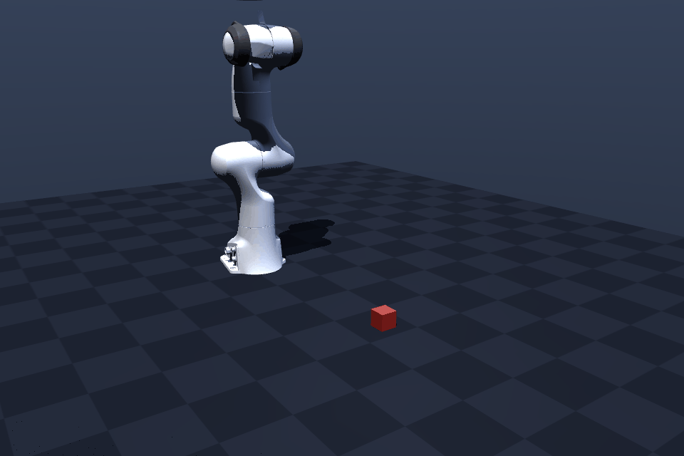

# robot-sim-first-step

**零基础、不会编程，也能跑起来的机器人仿真仓库。**
只用 MuJoCo + Python，5 分钟出第一张图，不需要显卡对齐、不需要几十 GB 的 Isaac Sim。



上面这段动画是真的刚体动力学算出来的：脚本只给"目标关节角 + 夹爪开合"，
每一帧的位置、接触、摩擦、重力全是物理引擎算的。方块被抬高 0.157 m，夹爪停在 0.042 m。

---

## 现在能跑什么

| 文件 | 干什么 | 你会看到什么 |
|---|---|---|
| `demo_00_check.py` | 验证 MuJoCo 装好了、能出图 | 打印 `OK`，生成 `demo_00.png` |
| `demo_01_pendulum.py` | 单摆：不加控制 / 只有 PD / PD+重力前馈 | 三条曲线，第三条误差 0.00 度 |
| `demo_02_arm.py` | 二连杆机械臂，雅可比伪逆够目标点 | 末端误差 0.0000 m |
| `demo_03_camera_dataset.py` | 机器人 + 相机 + 采集数据集 | `.npz` 数据集 + 8 格相机画面 |
| `demo_04_panda_grasp.py` | **Franka Panda 七轴真机模型抓方块** | 五段关键帧 + mp4 + gif |
| `demo_05_toolpath.py` | **轨迹跟踪：开环 vs 闭环（这就是"刀路图"）** | 目标 vs 实际 3D 对比 + 偏差曲线 |
| `check_reach.py` | **可达性扫描**：哪些抓取高度物理上可行 | 逐高度判定表 + 最低安全高度 |
| `diag_gripper_geom.py` | 量出夹爪真实几何（指垫中心在哪） | 指垫长 55.6 mm，中心偏移 0.0862 m |

> 注意：`demo_04` 依赖 `models/panda/`，那是 [MuJoCo Menagerie](https://github.com/google-deepmind/mujoco_menagerie) 的官方模型（Apache-2.0），已经放在仓库里。

---

## 三步跑起来

这台机器上已经有个装好的环境：**`D:\robot-env`**（Python 3.12.15 + mujoco 3.17.0）。
不用重复装，直接用它的解释器跑就行。

```powershell
cd D:\codex\projects\robot-sim-first-step

# 跑第一个（自检）
D:\robot-env\Scripts\python.exe demo_00_check.py
```

跑 Panda 抓取：

```powershell
D:\robot-env\Scripts\python.exe demo_04_panda_grasp.py
```

**如果换一台电脑**，比如带去学校或给同学：

```powershell
cd <新路径>\robot-sim-first-step
uv venv --python 3.12 .venv
uv pip install --python .venv\Scripts\python.exe -r requirements.txt
.venv\Scripts\python.exe demo_00_check.py
```

验证过的版本：**Python 3.12.15 / mujoco 3.17.0 / numpy 2.5.4 / matplotlib 3.11.2 / imageio 2.38.1**，
平台 Windows 11 + RTX 5070 Ti Laptop。**CPU 也能跑，MuJoCo 不需要显卡。**

---

## 每个 demo 在教你什么（一句话）

- `demo_00`：仿真器是什么——`model`（描述世界）+ `data`（世界的当前状态）+ `mj_step`（推进时间）。
- `demo_01`：**控制**是什么——误差、PD、以及"为什么光有 PD 会有静差"。
- `demo_02`：**运动学**是什么——关节角怎么变成末端位置，反过来怎么解（雅可比伪逆）。
- `demo_03`：**具身智能的数据长什么样**——`(图像, 关节角, 动作, 目标)`。
- `demo_04`：**真实机器人流程**——IK 解路点、伺服跟踪、接触与摩擦、成败判定。
- `demo_05`：**怎么知道对不对**——目标路径和实际路径叠在一起看，开环误差随速度累积，闭环把它压住。

---

## 为什么先 MuJoCo，不先 Isaac Sim

| | MuJoCo | Isaac Sim |
|---|---|---|
| 安装体积 | < 300 MB | 数十 GB |
| 出第一张图 | 5 分钟 | 半天起 |
| 语言 | 纯 Python API | Python，但依赖 Omniverse |
| 显卡 | 不需要 | 强依赖（官方最低 RTX 4080 / 16GB 显存） |
| 生态 | DeepMind 维护，论文常用 | NVIDIA 主推，大规模并行训练强 |

你现在 5070 Ti Laptop（12 GB 显存）+ 32 GB 内存，Isaac Sim 属于"勉强能装、大概率被驱动和版本折磨"。
**先用 MuJoCo 把"模型 / 状态 / 步进 / 渲染 / 控制 / 接触"这六件事吃透**，之后换 Isaac Sim 只是换 API 名字。

这不是我一个人的判断：[Datawhale《动手学具身智能》](https://datawhalechina.github.io/dive-into-embodied-ai/)
的 6 个仿真实战项目（四足 / Pupper / Quaddle / MicroDuck / 机械臂 DDPG / ACT 双臂）**全部用 MuJoCo，一个 Isaac 都没有**。

---

## 我在社区路径的哪一格

社区里几条权威路线（古月居、Datawhale、Xbotics）的共识顺序是：

```
建模 → 控制器(PID/阻抗) → 轨迹跟踪 → 运动规划 → 强化学习 / 模仿学习
```

对照古月居 10 节课的大纲（RL 排在第 8 节，前 7 节全是建模+控制），**本仓库覆盖到第 4–5 节**：
会建模（`MjSpec`）、摸到控制器接口（`ctrl` + PD + 重力前馈）、能做 IK 抓取。

**还没做的是第 6–7 节：PID 整定和轨迹跟踪。** 这是下一步。

详细调研见 [`docs/07-community-learning-paths.md`](docs/07-community-learning-paths.md)。

---

## 已知限制（诚实写清楚，比吹牛有用）

1. `demo_02` 是**运动学**仿真：直接改 `qpos`，会穿模，不受力。`demo_04` 才是真动力学。
2. `demo_04` 的 IK 解算后经 `reachability.py` 做可达性检查（关节限位 / 力矩 / 碰撞 / 伺服误差），
   但路径仍是手工给的三个路点，没有自动避障规划。
3. 方块是 4.3 cm 立方体，**比 Panda 指垫短 12.6 mm**，所以抓取中心最低 z=0.0318 m（几何约束，见 docs/06）。
   换更大的物体要改 `CUBE_HALF`，并检查夹爪行程够不够。
4. 仓库里的 Panda 模型来自 Menagerie，`link2.stl`（碰撞网格）用 `link1.stl` 顶替，
   原因是下载镜像对 >50 MB 的包做了限制。**视觉网格全部是原版，物理碰撞体有这一处近似。**
5. 没有做 sim-to-real，也没有真机。

---

## 目录

```
robot-sim-first-step/
├─ demo_00_check.py              环境自检
├─ demo_01_pendulum.py           控制入门
├─ demo_02_arm.py                运动学入门
├─ demo_03_camera_dataset.py     相机 + 数据集
├─ demo_04_panda_grasp.py        真机模型抓取
├─ demo_05_toolpath.py           轨迹跟踪：开环 vs 闭环（刀路图）
├─ looks.py                      视觉配置（材质/灯光/天空盒，只影响画面不影响物理）
├─ reachability.py               可达性检查（限位/力矩/碰撞/伺服误差）
├─ check_reach.py                抓取高度扫描示例
├─ diag_gripper_geom.py          夹爪几何测量（FINGER_OFFSET=0.0862 的依据）
├─ diag_closed_loop.py           闭环增益/前馈扫描（gain=8, lead=1 的依据）
├─ models/panda/                 Franka Panda（MuJoCo Menagerie, Apache-2.0）
└─ docs/                         每一步的原理笔记
   ├─ 01–05                      按 demo 顺序的原理
   ├─ 06-why-numerically-exact-still-fails.md   四层误差诊断
   └─ 07-community-learning-paths.md            社区学习路径调研
```

---

## 参考的社区资料

本仓库的路线不是自己想的，主要对照这三份：

- [古月居《MuJoCo 机器人强化学习仿真入门》](https://www.guyuehome.com/detail?id=1825501975181848577) —— 10 节大纲，RL 排第 8
- [Datawhale《动手学具身智能》](https://datawhalechina.github.io/dive-into-embodied-ai/) —— 6 个 MuJoCo 实战项目 + 3 个交互式 playground
- [Xbotics《Roadmap to Embodied AI》](https://github.com/Xbotics-Embodied-AI-club/Xbotics-Embodied-Guide) —— 10 条 4–8 周路线，带验收标准

---

## License

代码 MIT。`models/panda/` 来自 MuJoCo Menagerie，遵循 Apache-2.0，见该目录下 `LICENSE`。

## 引用

如果你在作业或文章里用到这里的仿真结果：

```bibtex
@misc{robot-sim-first-step,
  title  = {robot-sim-first-step: 零基础机器人仿真第一课},
  year   = {2026},
  note   = {MuJoCo-based minimal robot simulation demos}
}
```
