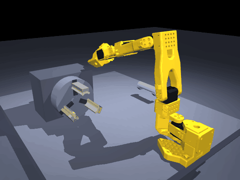

# v0.1.0 — 第一个工位跑通：圆柱工件真的被抓起来了

> 发布日期：2026-11-06
> 标签：`v0.1.0`
> 对照提交：2026-11-06 的 `main`
>
> **历史快照**：本文记录 v0.1.0 发布时的状态。里面的指标、待办和下一版本计划都已过时；当前状态以仓库根目录 README 为准。

第一个可用版本。车床上下料这个工位做到"接触可信"：工件不是被运动学锁钉在
手上，而是被夹爪几何和真实接触力抓住、搬过去、送进三爪卡盘。



## 这个版本能做什么

```bash
python src/diag_feed_chuck.py --v-jaw --lift --no-lock
```

```
同轴度        1.71 mm
轴线倾斜       0.0°        （按轴线方向算，不是四元数转角）
三爪接触        6 点
重力下沉      0.00 mm
20 N 拉拔     0.00 mm
三爪法向力    36.2 N
carry        physics       ← 搬运段无运动学锁
卡盘外壳      solid         ← 机器人撞得住，不再穿模
```

`python verify_all.py` → **8/8 PASS，约 26 秒**，纯 CPU，不需要显卡。

## 这一版改了什么

**夹爪从平板换成 90° V 槽。** 平板夹圆柱只有线接触，闭合就歪 46°、5 N 下拉滑
467 mm——不是摩擦系数的问题，扫过 μ 没用。V 槽靠几何自定心，4 点接触。

**修掉三个叠在一起的几何错误**，每一个单独看都像"摩擦不够"：

1. 夹爪闭合方向斜着搓工件：`wrist_roll=1.55` 下活动指有 50% 行程沿工件轴向，
   换成 −0.95 后降到 12%。
2. 两片指垫本来不同轴：原装 SO-101 固定指面比活动指面靠后 14.8 mm，各切一个
   V 槽 → 两个槽口沿轴错开 15.4 mm，夹爪是在"啃"圆柱。统一轴向工位后错开
   1.9 mm，轴线偏离 20° → 4.3°。
3. 瞄准点随开合漂 21 mm：只有一片指在动，两片指垫中点每次开合滑半个行程。
   把两个 `grasp_ref` 钉在不动的那片指上，TCP 恒定。

**新增抓取判据** `src/check_grip_hold.py`：低摩擦 + 定量下拉 + 抬起跟走 +
逐条接触力，四条一起判。这是仓库里最值得拿出去的部分——现有项目多用
task-level attachment 或端到端成功率倒推，不给这种可复现的接触判据。

**新增两个探针**：`probe_tilt.py`（闭合瞬间逐条接触的力矩分解）、
`probe_grasp_pose.py`（扫手腕角，量行程沿轴占比 / 闭合方向倾角 / 中点漂移）。

## 已知问题（下一个版本修）

1. **送进卡盘是斜着穿模过去的。** 卡盘外壳大概率没参与碰撞，只有三根爪有接触位。
   指标不假，但路径在物理上不成立，真机会撞床身。→ 补外壳碰撞 + 改成
   "退到端面外安全点 → 对正轴线 → 沿轴进给"。
2. **画面一顿一顿。** 两个进程靠文件传帧，`os.replace` 在 Windows 上被读端占用
   时会失败，丢帧是静默的。
3. **机械臂走位一晃一晃。** `move3()` 的闭环是"走一段 → 量误差 → 乘 0.8 再走"，
   误差反号时来回摆。
4. 默认路径（第 7 项检查）的搬运段仍用 `kinematic_lock`；V 槽按 Φ20 定，
   Φ15~Φ25 变径还没做。

## 接下来

- v0.2.0：修穿模与送进轨迹（让路径在物理上成立）
- v0.3.0：参数化实验——爪型 / 直径 / 摩擦扫描，写成能引用的报告
- v0.4.0：相机标定 + 视觉引导抓取
- v1.0.0 的目标不是"训练跑通"，是**泛化**：换工件初始位姿仍能成功

## 怎么跑

```bash
git clone https://github.com/penguinkinggod/mujoco-robot-cell.git
cd mujoco-robot-cell
uv venv --python 3.12 .venv
uv pip install --python .venv/Scripts/python.exe -r requirements.txt
python verify_all.py
```

版本组合实测：Python 3.12.15 / mujoco 3.17.0 / numpy 2.5.4。

---

这是一份历史版本快照，不代表当前状态。当前入口见仓库首页；旧过程记录保存在 [`docs/archive/PROJECT-NOTES-2026-11-06.md`](../archive/PROJECT-NOTES-2026-11-06.md)。
