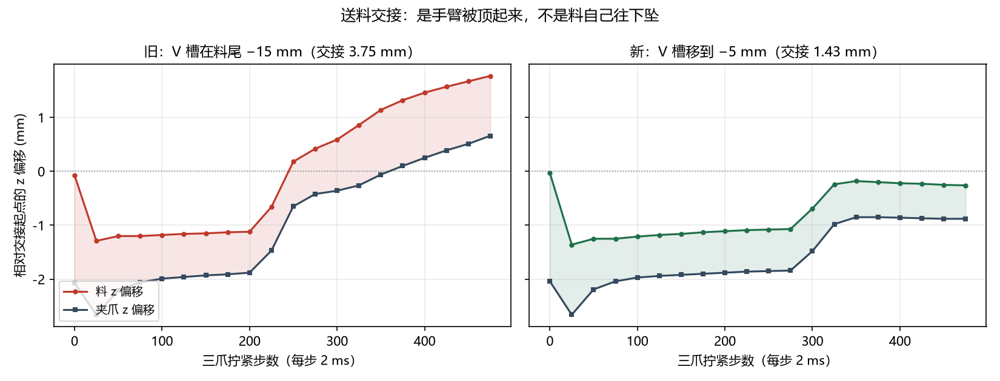

# 送料这一条怎么走

> 车床工位技术记录；当前状态以仓库首页为准。

真实车床上下料不是「抓着料怼进去」，要解决的是夹哪儿、怎么对、谁先松手。

当前抓取路径的关键修正：棒料放在两端 V 托架上，先从上方到 V 槽外侧，再沿 V 槽实际开口法向侧向进入，最后下降并闭合。旧的纯竖直下降会让固定侧 V 刀片先撞上棒料，抓取段最大位移约 6.97 mm；侧向进入后同一指标实测约 0.109 mm，三次重复一致。方向由当前模型里固定、活动 V 槽口中心连线计算，并去掉棒料轴向分量，不写死世界坐标方向。

本次完整无锁送料三次重复指标一致：最终同轴误差 1.53 mm、轴向偏差 2.2°、29 个卡爪接触、重力下沉 0.31 mm、20 N 拉拔位移 0.03 mm。交接过程中同轴误差短时到 3.15 mm，最终退开后回到 1.53 mm；因此最终装夹通过回归阈值，但交接瞬态仍值得后续改善。

```
        ┌── 夹爪夹尾段（15 mm）
        │
   ┌────┴────┐
   │███████████████───────────┐        ← Φ20 × 80 棒料
   └──────────────────────────┘
   被夹住 15 mm        自由端 65 mm，其中 25 mm 进卡盘
                        ↑
                  卡爪停在这里，机械臂不越过去
```

| 步骤 | 怎么做 | 实测残差 |
|---|---|---|
| 1 接近 | 先到 V 槽口外侧，不直接竖直压向棒料 | 棒料位移 < 0.001 mm |
| 2 进入 | 按当前姿态测出的 V 槽开口方向侧向进入，再下降到轴心 | 抓取段最大位移 0.109 mm |
| 3 夹 | V 槽缓慢闭合，四个刀片接触 | 约 72 N / 4 个接触 |
| 4 抬 | 五轴「位置 + 圆柱轴线」IK，把料调成水平 | 轴向偏 0.1° |
| 5 对 | 高位横移到卡盘轴线正上方，留 30 mm 间隙 | 进给前同轴约 12.67 mm，闭环修正后 0.08 mm |
| 6 进 | 只沿 +x 进给，插入深度是参数，不是碰运气 | 同轴 0.08 mm |
| 7 夹 | 三爪闭合夹紧，力由力限封顶；手臂柔顺让位 | 30 个接触、约 166 N；首次接触把同轴推到 4.20 mm |
| 8 松 | 三爪夹住后原地缓松，手不动 | 交接位移峰值 4.77 mm，主要来自夹紧瞬态 z +2.85 mm |
| 9 退 | 完全脱离后再撤，不是边松边退 | 最终同轴 0.87 mm、倾斜 0.3°、下沉 0.00 mm |
| — | **过程姿态仍未达标**，当前只作为无作弊基线 | 详见 [CURRENT.md](../../CURRENT.md) |

第 6、7 步的顺序是踩出来的。边张爪边撤离会把料刮走（同轴 1.6 → 283 mm）。得先原地把
手指张开到完全不接触，再动臂。

第 3 步那个 0.65 mm 是这套工位的精度上限。卡盘从 x = 0.20 移到 0.28 才够得着（扫工作
空间发现 x < 0.15 m 时 `shoulder_lift` / `wrist_roll` 顶限位、仍差 17.9°），而 SO-101
在 0.4 m 处的位置伺服本身有 4 mm 量级的下垂，靠闭环补到这个数。

## 交接那一下

工件从机器人手里转到卡爪手里，中间有个瞬间谁都不能碰它。机器人还夹着，卡爪又去夹，
两个夹具抢同一根轴，输的那台伺服被拖偏（实测 6.46 mm）；机器人松手了但手还在原位，
卡爪把工件往里推，会推着还张着的指垫后退（实测 12.07 mm）。

原来的答案是先把工件钉死在世界坐标、手臂退开 55 mm、三爪再夹紧。但 `lock()` 只固定
`qpos`，不消除接触力：卡爪推工件的力会经指垫传到手臂，手臂一退让，锚在手臂上的锁就把
工件一起搬走。所以必须有那么一个谁都不碰它的瞬间。

这条不在任何教程里，是三次失败量出来的。现在这版更干脆，先原地松手（手不动、只张爪）
再退，连「钉死」都不需要。

## 交接定案已作废，先做卡盘基准（2026-11-07）

用户追的不是最终同轴，而是交界那几下：往左上怼、放掉下沉、夹紧又动。逐帧量化发现
三爪**第一次碰到料**就把中心从 0.08 mm 推到 4.20 mm，而 25 mm 插入 / 55 mm 悬空段
在夹爪松开瞬间没有径向支撑。

曾试过「实体导套 + 先松夹爪 + 端面顶正 + 径向托力渐变卸载」，把交接位移从
4.77 压到 1.05 mm，一度当作定案。拆开对照后**用户否掉了**：真正把料摆回轴线的是
`seat_rod()` 里以理论主轴轴线为目标的 `qfrc_applied` 数学弹簧，等于替机械臂完成
最后对中。关掉它只留导套，导套反以 483 N 把料别到 14.2° FAIL。真机没有「知道
轴线在哪」的力场，所以这组结果不算机械臂送料成功，默认已全部回退为关。

现在按用户定的规矩**分两层验收**：

- **卡盘基准** `python src/diag_chuck_seat.py`：只摆料、不用机械臂、不建对中力场。
  24 组（插入 25/47 mm × 初倾 0/1/2° × 初偏 0/1/2/4 mm）全部 OK，初偏 4 mm
  也能被三爪拉回轴线，20 N 拉拔 ≤0.021 mm；`外力max=0.0`、`臂碰=0`，不是假通过。
  **结论：卡盘自己能夹正偏料，卡盘侧不用改，也不必先做路径优化。**
- **机械臂送料** `python src/diag_feed_chuck.py --v-jaw --lift --no-lock`：当前默认
  就是无作弊基线，交接位移 4.77 mm，**过程姿态未达标，是下一步的真问题**。

卡盘基准里 47 mm 插入比 25 mm 稳得多，但机械臂够不到（`FEED_INSERT_MM=47` 时
IK 残差 26.8 mm、夹紧前同轴 20.12 mm）；要用它得先改工位/夹爪站位。

两个 MuJoCo 坑（导套代码仍保留，默认不装）：碰撞掩码在**编译期**烘焙，运行时改
`geom_conaffinity` 不产生接触；要模拟「张开/合上」就改 `geom_pos`（每步重算）。
静态环若常驻闭合，会横在搬运路径上把棒料撞掉——真机中心架也是送料时张开的。

## 交接位移 4.77 → 3.75 mm：先修归因，再修动作（2026-11-07）

上一节把"三爪第一次碰料把料怼出去 4.20 mm"当成结论。加了逐帧跟踪
（`FEED_CLAMP_TRACE=1`）后发现这个归因是错的：

> 卡爪**还没碰到料**（接触=0）的前 300 步，料已经从 −0.04 漂到 +3.29 mm，
> 而且和夹爪同步移动（爪 −2.43 → +3.05）。

夹紧斜坡前 65% 行程卡爪还在空走（张开内径 44 mm vs 料 Ø20），这段时间手臂在
0.2 kg 悬臂负载下持续变形，同时位置伺服还在追进给终点 2.5 mm 的 IK 残差，
夹爪就带着料漂了 3.3 mm。三爪真正接触时料已经偏了，咬合同轴只是继承这个偏移。

顺带查到 mg 托力是漂移源之一：它纯 +z，但料躺在**斜 V 槽**里，往上顶就沿斜面滑。

据此改了三处，全部是机械臂自身动作 + 真实工装几何，没有任何指向理论轴线的力：

1. **终点锚定**：进给到位后把伺服目标一次性同步到实际关节角，不再追旧目标。
2. **去掉棒料 mg 托力**：交接期棒料外力峰值从 1.933 N 降到 **0.000 N**。
3. **下半环托料架**：卡爪口外 `x=[−20,−6] mm` 六块 box 拼下半圆，内孔间隙
   1.6 mm，只碰工件。送料时张开 40 mm 避开搬运路径，进给到位才合上。

| 指标 | 回退后的诚实基线 | 现默认 |
|---|---|---|
| 三爪首次接触 | 4.20 mm | **3.06** |
| 夹紧瞬态 z | +2.85 mm | **+2.20** |
| 交接全程位移 | 4.77 mm | **3.75** |
| 原地松爪 同轴/倾斜 | 2.69 mm / 1.8° | **2.33 mm / 1.4°** |
| 最终 同轴/倾斜 | 0.87 mm / 0.3° | 0.74 mm / 0.7° |
| 余量偏心 | 1.05 mm | **0.92** |
| 交接期棒料外力峰值 | 1.933 N | **0.000** |

间隙取 1.6 mm 的原因：1.46~2.0 mm 连续 PASS，<1.44 mm 出现 0.02 mm 级的接触
离散化跳变（1.38/1.40/1.44 会 FAIL），说明那不是可用的参数窗口。咬合与解锁
静置时实测 `导套=0/0.0N`，托架没有参与对中，拉拔/下沉不是被托出来的假通过。

常驻托架为什么不行：前段极好（咬合 0.87 mm、交接 2.67 mm），但三爪**夹空**——
实测 `三爪咬合 接触=0 力=0.0 N、导套=2/107.7 N`，料被托架卡在卡爪口外；
把托架在三爪夹紧后退回，松爪段又会掉 10 mm。

## 交接位移 3.75 → 1.43 mm：杠杆在夹持点，不在"悬空 55 mm"（2026-11-07 续）

上一节把 3.4~3.8 mm 当成 SO-101 的物理下限，这个判断是错的。把逐帧跟踪
拆成两个量——**爪沉**（夹爪自身的 z）和**料相对爪**（料在 V 槽里的位移）——
画面立刻变了：

- 料自己往下掉只有 **1.25 mm**（前 225 步，卡爪接触=0），而且是料在 V 槽里
  **落座**（相对爪 −1.27 mm，之后不再变）。
- 剩下 2.5 mm 是**反方向**的：三爪咬上后把料和夹爪一起往上顶，爪 z 从 −0.86
  爬到 +3.36 mm。软伺服扛不住这个推力，只能跟着抬。

为什么会被顶起来：V 槽原来在**料尾 −15 mm**，料重心离夹持点只有 15 mm，但
夹爪到手腕是硬杠杆，三爪的推力经料传到夹爪，被放大成毫米级位移。把槽挪到
料重心前 5 mm（`FEED_GRIP_STATION_MM=5`）：

| 站点 | 三爪咬合 | 交接位移 | 松爪 dz | 最终同轴/倾斜 | 余量 |
|---|---|---|---|---|---|
| −15 mm（旧） | 3.06 mm | 3.75 mm | −1.42 mm | 0.74 mm / 0.7° | 0.92 |
| −25 mm（贴尾端） | 夹空掉料 | 17.03 mm | — | 21.85 mm / 47.1° | FAIL |
| **−5 mm（新默认）** | **0.37 mm** | **1.43 mm** | **−0.02 mm** | **0.44 mm / 1.2°** | 1.15 |
| 0 mm（料中心） | 0.32 mm | 1.42 mm | −0.02 mm | 0.41 mm / 1.2° | 1.03 |

0 与 −5 差 <0.02 mm，取 −5 留 20 mm，夹爪本体不贴卡爪口。

**顺带修掉一个真 bug**：原来松爪后一把斜撤到 `axis+(0.02,−0.12,0.16)`，张开的
刀片会横刮还没脱离的料尾。−5 站点上这一步把已定心的料从 0.44 拖到 1.20 mm、
倾斜 1.2 → 2.0°，余量 2.45 mm 判 FAIL。改成**先沿轴线退 70 mm，再侧向撤离**
（`FEED_RETREAT_AXIAL=1`）后退出段对料零影响（dz 0.00）。

**还没解决的**：交接前料在 V 槽里还有 1.3 mm 落座。修法是抓起后先竖直提一下、
等料坐进槽底再搬，属于动作改动，不动工装几何。



回到 [README](../../README.md) · 全部工位资料见 [索引](README.md)
